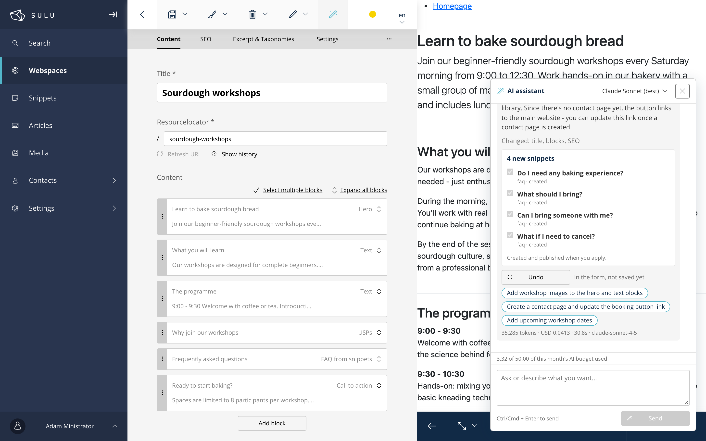

# Sulu AI Content Bundle

An AI writing assistant for Sulu 3. Editors write new pages and rework existing ones from your own
templates and blocks, in the voice you describe per webspace, with any model through Symfony AI.
Nothing is saved behind their back: the assistant fills the form, the preview shows the result, and
every question is logged with its tokens and cost.

## What's inside

- [**An assistant next to every form**](https://sulu.eekes.be/sulu-ai-content-bundle/assistant): write a page, rework it, rewrite one block, SEO and excerpt, translate - with questions first, an outline to approve and undo for every change. It reuses and proposes snippets and sets the filters of smart content lists with real categories, tags and pages.
- [**Several pages at once**](https://sulu.eekes.be/sulu-ai-content-bundle/planner): plan a new section or a series of articles with the assistant, then have every page written and created as an unpublished draft.
- [**Your blocks, described once**](https://sulu.eekes.be/sulu-ai-content-bundle/block-catalog): a command describes every template and block in a YAML file you fine-tune, with fields the assistant must leave alone.
- [**AI context per webspace**](https://sulu.eekes.be/sulu-ai-content-bundle/ai-context): what the website is, the audience, tone of voice, words to use and avoid, a glossary and example pages, per locale.
- [**A full usage log**](https://sulu.eekes.be/sulu-ai-content-bundle/usage-log): who asked what, which model, input, output and cached tokens, estimated cost, duration and tool calls - plus a monthly budget.
- [**Any model**](https://sulu.eekes.be/sulu-ai-content-bundle/configuration): Anthropic, OpenAI, Mistral, Gemini, Ollama and every other Symfony AI platform; the API key stays in your environment.
- [**Extending**](https://sulu.eekes.be/sulu-ai-content-bundle/extending): field schemas for your own content types, tools of your own, replaceable services.

How one turn works: [how it works](https://sulu.eekes.be/sulu-ai-content-bundle/how-it-works).

## Documentation

[Installation](https://sulu.eekes.be/sulu-ai-content-bundle/installation), [configuration](https://sulu.eekes.be/sulu-ai-content-bundle/configuration) and everything else: **[sulu.eekes.be/sulu-ai-content-bundle](https://sulu.eekes.be/sulu-ai-content-bundle)**.

## License

MIT
